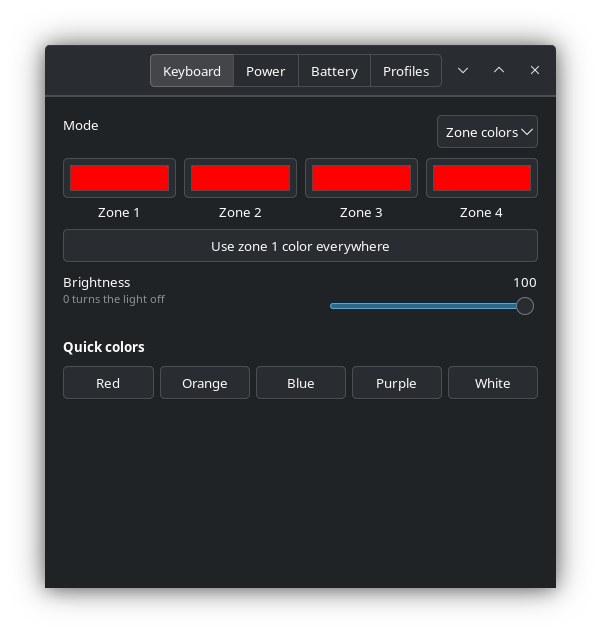
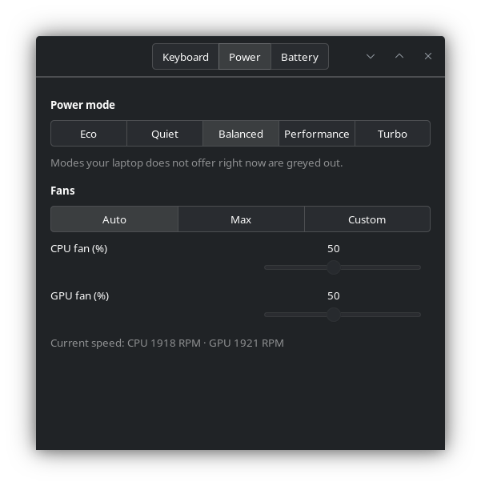
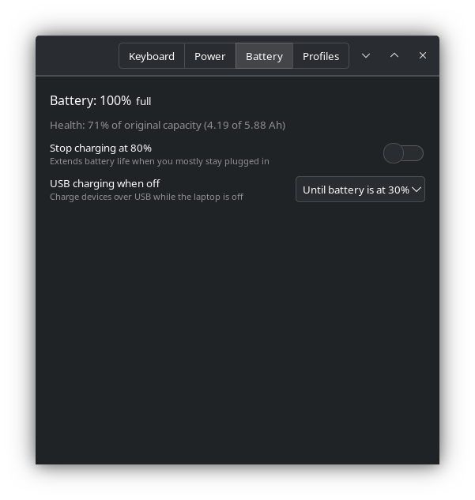
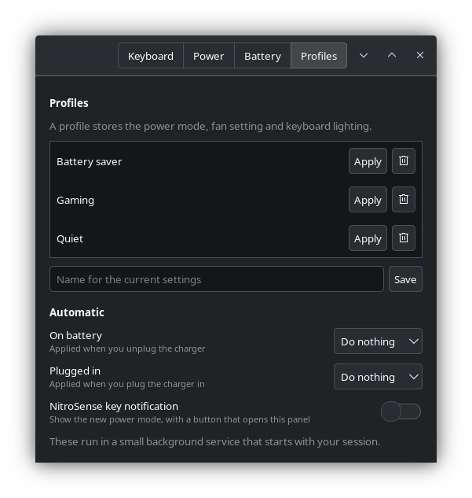
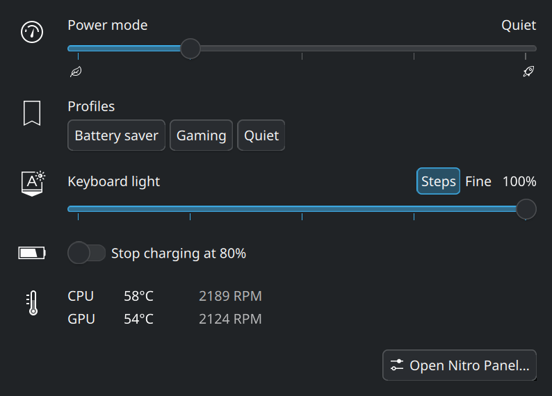

# Nitro Panel

[](https://github.com/Ardakorkmaz0/nitro-panel/actions/workflows/ci.yml)

A small GTK control panel for Acer Nitro and Predator laptops on Linux: keyboard RGB, power modes, fans and battery settings in one window.

Nitro Panel is only the front end. The hardware access comes from the [Linuwu-Sense](https://github.com/0x7375646F/Linuwu-Sense) kernel module, which has to be installed first.

> Not affiliated with or endorsed by Acer.

| Keyboard | Power |
|---|---|
|  |  |
| **Battery** | **Profiles** |
|  |  |

## Features

- **Keyboard** (four-zone RGB keyboards): a color per zone, or one of seven effects (breathing, neon, wave, shifting, zoom, meteor, twinkling) with speed and direction. Brightness in NitroSense's steps (off, 25, 50, 75, 100%) or in steps of 1, and quick colors. The light can turn off after 30 seconds without typing, or stay on.
- **Power mode**: Eco, Quiet, Balanced, Performance and Turbo. Modes your laptop does not offer right now (Turbo on battery, for example) are greyed out.
- **Fans**: auto, max, or a custom CPU/GPU percentage.
- **Sensors**: CPU and GPU temperature and fan RPM. They come from the embedded controller, so reading them never wakes a sleeping NVIDIA GPU.
- **Battery**: charge level and health (current capacity against the original), stop charging at 80%, and USB charging while the laptop is off.
- **Profiles**: save the power mode, fan setting and keyboard lighting under a name and apply them with one click. Gaming, Quiet and Battery saver are there to start with.
- **Automatic**: apply a profile when you unplug or plug in the charger.
- **NitroSense key**: show the new power mode when you press the key, with a button that opens the panel.
- **Plasma widget**: power mode, profiles, keyboard light, the 80% charge limit and sensors in the KDE system tray. Its icon shows the current power mode.

The panel only shows the controls your model exposes. Changes apply immediately; there is no Apply button.

## Plasma widget



On KDE Plasma 6, `make install` also installs a system tray widget, laid out like Plasma's own Power and Battery popup. It shows up in the tray by itself after you log out and back in. Restarting only plasmashell also works, but on Plasma 6.8 it can hang while quitting and leave the screen black until it is killed (`systemctl --user kill -s KILL plasma-plasmashell`), so logging out is the safer way. After updating Nitro Panel, log out and back in as well, so Plasma loads the new widget. To hide it, open the tray's settings and set **Nitro Panel** to hidden or disabled under Entries.

The widget does nothing on its own: it reads `nitro-panel --status` and runs the command line options below.

## Command line

```text
nitro-panel                         open the panel window
nitro-panel --status                print the current state as JSON
nitro-panel --mode MODE             eco, quiet, balanced, performance or turbo
nitro-panel --profile NAME          apply a saved profile
nitro-panel --kb-brightness 0-100   keyboard light brightness, colors stay the same
nitro-panel --battery-limit on|off  stop charging at 80%
nitro-panel --kb-fine on|off        brightness in steps of 1 instead of off/25/50/75/100%
nitro-panel --kb-timeout on|off     turn the keyboard light off after 30 s without typing
```

These options do not load GTK, so they return quickly and work well in scripts and keyboard shortcuts.

## Tested models

| Model | Result |
|---|---|
| Acer Nitro AN16-41 (Ryzen 7040, RTX 4070) | Everything works |

Other models supported by Linuwu-Sense should work too. If you try one, please open an issue with your model name and what worked.

## Requirements

- The Linuwu-Sense kernel module, loaded (`lsmod | grep linuwu_sense`). On Arch it is in the AUR as `linuwu-sense-dkms-git`, or build it from [source](https://github.com/0x7375646F/Linuwu-Sense).
- Python 3, PyGObject and GTK 3. On Arch: `sudo pacman -S python-gobject gtk3`.
- Your user in the `linuwu_sense` group, which Linuwu-Sense creates.
- For the tray widget: KDE Plasma 6.

## Install

```bash
git clone https://github.com/Ardakorkmaz0/nitro-panel
cd nitro-panel
sudo make install
```

Then add yourself to the group and log out and back in:

```bash
sudo usermod -aG linuwu_sense $USER
```

Open **Nitro Panel** from your application menu, or run `nitro-panel`.

To remove it, run `sudo make uninstall` in the same folder.

On Arch you can also build a package with the PKGBUILD in [`packaging/aur`](packaging/aur):

```bash
cd packaging/aur && makepkg -si
```

## How permissions work

Nitro Panel runs as your normal user and never as root.

- Linuwu-Sense makes its keyboard, fan and battery files writable by the `linuwu_sense` group.
- `make install` adds a tmpfiles rule (`data/nitro-panel.tmpfiles.conf`) that does the same for `/sys/firmware/acpi/platform_profile`, so the group can change the power mode too.
- Without that rule, changing the power mode asks for your password through polkit.

## Background service

The **Automatic** settings and the NitroSense key notification need `nitro-panel --daemon`, a small service in your user session (`nitro-panel-daemon.service`). The panel switches it on when you turn one of these settings on, and off again when none is in use. Profiles are saved in `~/.config/nitro-panel/config.json`.

- It applies the profile after Linuwu-Sense has finished its own charger handling. The driver already remembers a power mode for battery and for plugged in; the profile then sets the mode, fans and keyboard you chose.
- The NitroSense key gives no key code to the desktop. Linuwu-Sense handles it in the kernel, switches to the next power mode and writes a line to the kernel log. The service watches for that line, so your user must be able to read the kernel log (`journalctl -k` without sudo). On Arch, members of `wheel` can; others can join `systemd-journal`.

## Good to know

- **Keyboard light timeout on Nitro models:** with Linuwu-Sense as it is today, switching the timeout off makes the light go out 2-3 seconds after the last key press instead of keeping it on. The driver sends 0x88402 there, which on Nitro means "zero seconds"; on an AN16-41, 0x8402 (bit 19 cleared) is what really keeps the light on. A fix is in [this Linuwu-Sense branch](https://github.com/Ardakorkmaz0/Linuwu-Sense/tree/nitro-backlight-timeout). Unless your Linuwu-Sense has it, leave the timeout on.

- Other tools can change the power mode as well: power-profiles-daemon, tuned, or the power widget in your desktop. The panel always shows the mode that is currently active.
- Linuwu-Sense saves your keyboard settings and restores them at boot.
- On some models the two wave directions may be swapped.

## Troubleshooting

| Message or problem | What to check |
|---|---|
| "The linuwu_sense kernel module is not loaded" | `lsmod \| grep linuwu_sense` and `dkms status`. After a kernel update, DKMS should rebuild the module. |
| "No write access yet" | Run `id -nG` and look for `linuwu_sense`. If it is missing, add yourself and log in again. |
| No Keyboard tab | Your model does not expose a four-zone keyboard through Linuwu-Sense. |
| Power mode asks for a password every time | The tmpfiles rule is not installed. Run `sudo make install` again. |
| No notification when pressing the NitroSense key | `systemctl --user status nitro-panel-daemon` should be active, and `journalctl -k -n 5` must work without sudo. |
| A profile is not applied when the charger changes | `journalctl --user -u nitro-panel-daemon` shows what the service did. |

## Development

The tests need no Acer hardware: they run against a fake copy of the driver's sysfs files.

```bash
pytest
```

The window tests need a display and are skipped without one. On every push and pull request, GitHub Actions runs all tests on Arch Linux, lints the Plasma widget and validates the desktop file.

**Releasing:** raise `__version__` in `nitro_panel.py` (the only place the version is written), add an entry for it to [`CHANGELOG.md`](CHANGELOG.md) and push to `main`. When the tests pass, GitHub Actions tags the commit and publishes the release, using the changelog entry as release notes.

## Credits

- [Linuwu-Sense](https://github.com/0x7375646F/Linuwu-Sense) for the kernel module.
- [acer-predator-turbo-and-rgb-keyboard-linux-module](https://github.com/JafarAkhondali/acer-predator-turbo-and-rgb-keyboard-linux-module), where much of the Acer WMI research started.

## License

[GPL-3.0-or-later](LICENSE)
